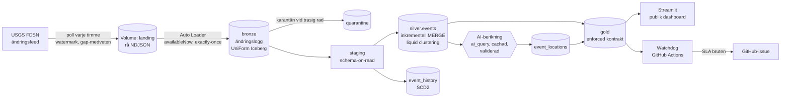

# Seismo – Malvin Portfolio Project

**Live demo:** _(länk läggs till efter deploy)_

En live lakehouse-plattform över **globala jordbävningar från USGS**: ändringsflöde (CDC) med revideringar och raderingar,
strömmande ingest, dbt med datakontrakt, en AI-berikning som är byggd för kostnad och tillförlitlighet, schemalagd drift med
larm, och en publik dashboard. Allt är körbart och verifierat mot de riktiga systemen.

Jag valde jordbävningsdata för att USGS *ändrar sig*: magnituder revideras och händelser raderas. Därför blir det en riktig
CDC- och SCD2-uppgift och inte en statisk CSV.

## Granska på fem minuter

| Du vill se | Titta här |
|---|---|
| Att det lever | Live demo ovan: karta, betydande skalv, trender och fliken **Plattformen** med färskhet och kvalitet |
| Hur jag resonerar | [`docs/adr/`](docs/adr): sju beslutsdokument, t.ex. Delta med UniForm mot native Iceberg |
| Hur det drivs | [`docs/runbook.md`](docs/runbook.md): larm, backfill, replay, schemaändringar |
| Kostnad och prestanda | [`docs/cost-and-performance.md`](docs/cost-and-performance.md): mätt, med antaganden synliga |
| Datakontraktet | [`docs/data-contract.md`](docs/data-contract.md) och [`dbt/models/gold/gold.yml`](dbt/models/gold/gold.yml) |
| Att det testas | [`tests/`](tests), [`dbt/tests/`](dbt/tests) och [`.github/workflows/`](.github/workflows) |

## Arkitektur



Jobbet `seismo-pipeline` körs varje timme med tre tasks: `poll_usgs` → `bronze_stream` → `dbt`. dbt-tasken kör kärnbygget, freshness-kontroll
och sist AI-stegen, så ett LLM-fel aldrig kan blockera kärndata.

## Vad som gör det till en plattform och inte ett skript

| Förmåga | Hur | Bevis |
|---|---|---|
| **CDC med revideringar och raderingar** | FDSN `updatedafter` som ändringsfeed, SCD2 i `event_history`, soft delete | USGS-raderingar fångas, revideringar blir `revision_number > 1` |
| **Idempotens och återhämtning** | Watermark ur bronze, versionsdedupe, atomiska filer, gap-medveten hämtning, resumable backfill | Omkörning skriver inga dubbletter. Se [runbook](docs/runbook.md) |
| **Strömmande ingest** | Auto Loader med checkpoint, `foreachBatch` med idempotenta skrivningar, karantäntabell | Exactly-once, trasiga rader stoppar inte strömmen |
| **Öppet tabellformat** | Delta med UniForm: tabellerna exponerar Iceberg-metadata | `DESCRIBE EXTENDED` visar Iceberg-metadata. [ADR 0001](docs/adr/0001-delta-uniform-instead-of-native-iceberg.md) |
| **Transformation som kod** | dbt: staging, silver, gold, makron, `persist_docs` till Unity Catalog | 10 modeller, 31 tester, 5 enhetstester |
| **Datakontrakt** | `contract: enforced`, `on_schema_change: fail`, PK/NOT NULL i Delta | Kontraktet stoppade en `decimal`/`double`-avvikelse innan konsumenter påverkades |
| **AI-berikning** | `ai_query` på ort-strängar, regex först, cache, kostnadstak, validering. [ADR 0006](docs/adr/0006-llm-enrichment-design.md) | 531 av 531 unika orter validerade. Hav hanteras som egen kategori |
| **AI som inte hittar på siffror** | Dagligt sammandrag där SQL räknar och modellen bara formulerar. Ett dbt-test kontrollerar texten | Se `gold_daily_briefing` |
| **Observability** | `poll_log` som hjärtslag, source freshness, hälsotabell, watchdog med GitHub-issue | Larmet ligger *utanför* pipelinen, så den kan inte tysta sig själv |
| **Miljöer och CI/CD** | Asset Bundle med `dev` och `prod`, ruff, pytest, `dbt parse --warn-error`, nattlig live-kontroll mot USGS | [`.github/workflows/`](.github/workflows) |
| **Minsta möjliga rättigheter** | Appen kör som en service principal med enbart `SELECT` på gold | Bevisat: skriva, radera och läsa andra scheman nekas |
| **Kostnadsmedvetenhet** | Mätt förbrukning ur faktureringstabellerna, scenarier, benchmark av layout | [`docs/cost-and-performance.md`](docs/cost-and-performance.md) |

## Det jag lärde mig av att köra mot riktiga system

Mycket av värdet i projektet kom ur att jag testade mot de riktiga systemen istället för att lita på mina antaganden. Några exempel,
alla dokumenterade i ADR:erna:

- **USGS saknar `updatedbefore`** (HTTP 400), och **`includedeleted=true` är sporadiskt extremt långsamt** (504 efter 60 s för vissa dagar). Mina
  mockade tester hade aldrig hittat det. Därför är raderingsavstämningen *best effort*, och ett nattligt live-kontraktstest vakar över API:et.
  ([ADR 0003](docs/adr/0003-fdsn-updatedafter-change-feed.md))
- **Databricks ignorerar min `profiles.yml`** och genererar en egen dbt-profil. Jag byggde om till den och tog bort mitt oanvända target.
- **Varje dbt-task betalar en egen miljöstart.** Freshness-kommandot tog 3 sekunder men tasken 3,8 minuter, så de delar nu task: körtiden gick från över 7 till under 4 minuter.
- **Min LLM-validering avvisade korrekta svar.** Hav har inget land, så "Mid-Atlantic Ridge" blev ogiltigt. Det syntes först när jag läste de råa svaren i produktion.
- **Warehouse-vakentiden, inte datamängden, styr kostnaden:** ca 86 % med timschema och 10 minuters auto-stop. Auto-stop på 1 minut sänker månadskostnaden med ca 63 %.

## Kör själv

```bash
databricks auth login --host https://<workspace>.cloud.databricks.com
databricks bundle deploy -t prod --var warehouse_id=<warehouse-id>
databricks bundle run seismo_pipeline -t prod --params bootstrap_days=7
```

Prova alltid ändringar i `dev` först (`-t dev`). Lokalt:

```bash
pip install -r requirements-dev.txt
ruff check . && ruff format --check . && pytest      # enhetstester
pytest -m live                                      # kontraktstester mot riktiga USGS
cd dbt && dbt parse --warn-error                    # validerar hela dbt-projektet utan anslutning
```

GitHub Actions kräver secrets `DATABRICKS_HOST`, `DATABRICKS_CLIENT_ID`, `DATABRICKS_CLIENT_SECRET` och `DATABRICKS_WAREHOUSE_ID` (watchdog).
Appens secrets finns beskrivna i `app/.streamlit/secrets.toml.example`.

## Struktur

| Sökväg | Innehåll |
|---|---|
| `pipeline/` | Notebooks (extraktion, bronze) och `seismo_lib.py`, ren Python som enhetstestas |
| `dbt/` | Modeller, makron, tester, enhetstester, kontrakt och exposure |
| `app/` | Streamlit-dashboarden |
| `ops/` | Watchdog och benchmark-notebook |
| `resources/`, `databricks.yml` | Asset Bundle: jobb, miljöer, schema |
| `docs/` | ADR:er, runbook, datakontrakt och kostnadsanalys |
| `tests/` | Enhetstester och live-kontraktstester |

## Begränsningar och vad jag skulle göra härnäst

- **Körs på Databricks Free Edition** med kvoter. Kostnaderna i analysen är beräkningar på listpris, inte debiterade belopp.
- **Orkestreringen är Databricks Jobs plus GitHub Actions**, inte Dagster eller Airflow, eftersom de kräver en värd som alltid är på ([ADR 0005](docs/adr/0005-orchestration-jobs-and-actions.md)).
  Modellerna är redan uppdelade i assets, så en migrering är att linda in dem med `dagster-dbt`.
- **Raderingsavstämningen är best effort** på grund av USGS egen opålitlighet, och historiska revideringar före första körningen går inte att återskapa.
- **Land är LLM-extraherat** och valideras strukturellt, inte faktamässigt.
- **Nästa steg:** terraform för schema och rättigheter, en dedikerad warehouse med 1 minuts auto-stop, och dbt-docs publicerade på GitHub Pages för lineage-grafen.

Data: [USGS Earthquake Hazards Program](https://earthquake.usgs.gov/). Kontrollera alltid officiella källor för säkerhetsbeslut.
